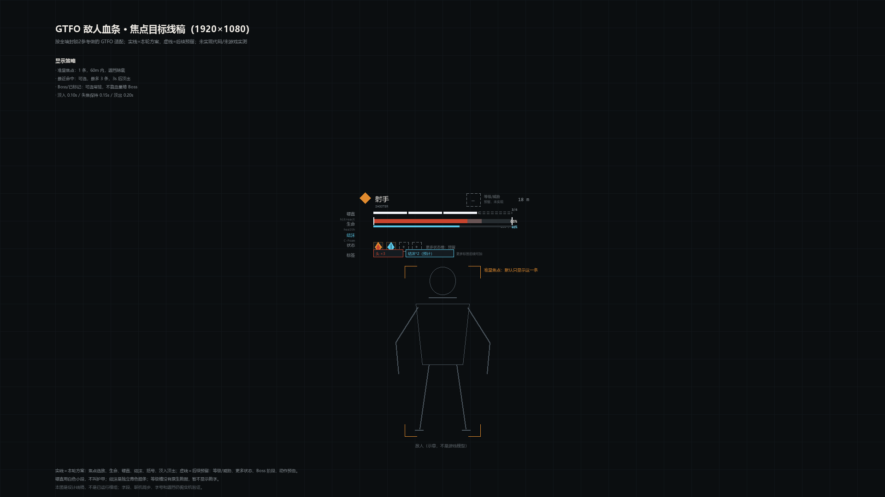
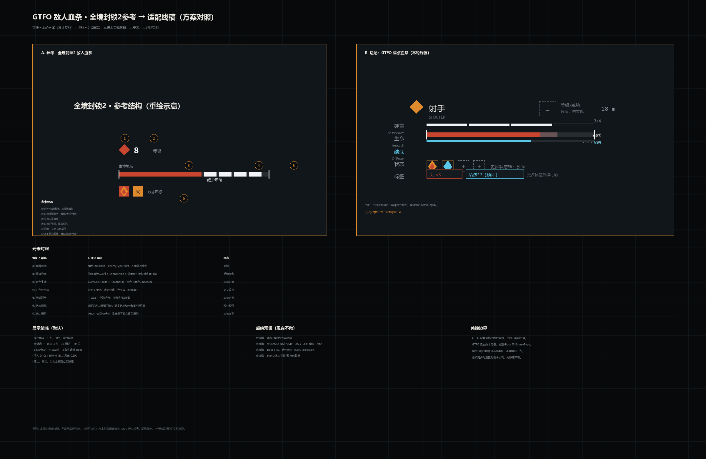
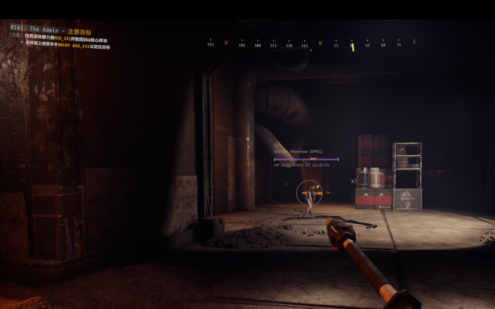

# Design notes

The visual target is a Division-style focus bar adapted to GTFO, not a copy of the Division HUD. The finalized proportions and hierarchy are:

## 1. Information hierarchy

1. Enemy identity: name + `EnemyType` category (and optional custom `TierText`).
2. Main health: red track, current fill, light gray lost-piece ghost.
3. Hard value: 4 white pips above health; label/meaning is **hitreact**, never armor.
4. Glue: thin cyan strip under health; `AttachedGlueRel`; stuck pulse; immunity label.
5. Status slots: fire/stuck/tagged/no-push/glue-immune; empty slots hidden by default.
6. Optional labels: weakspot count/multiplier, distance, level slot (hidden by default).

## 2. Proportions

- At 1080p: bar width 200 px, height 5 px; 90–420 / 2–16 configurable.
- Width/height/font scale with `Screen.height/1080` (0.75–2.5); at 4K the bar is about 2×, not a fixed 200 px.
- Radius of the end brackets 2 px; hard pips 4 px tall with 3 px gaps; glue strip 2–3 px.
- Bar is centered above the enemy, clamped to 10–46% screen height and 20 px side margin.
- Crosshair avoidance radius default 72 px; if the bar would cover the crosshair, it is moved above it.

## 3. Semantics

| Element | GTFO data | Rule |
| --- | --- | --- |
| Health | `Damage.Health/HealthMax` | Read live; no local-damage prediction |
| Hard value | `m_damBuildToHitreact` | 4 pips; if threshold ≈ health, use “poise” icon instead of a second health bar |
| Glue | `AttachedGlueRel`, `IsStuckInGlue`, `GlueTolerance` | independent cyan strip; `GlueTolerance ≥ 1,000,000` = immune |
| Burn | `OnFire`, `m_heatLevel` | status slot `F`; no fake duration |
| Weakspot | `DamageLimbs` weakspot + multiplier | label `WK n×m`; not a separate health bar |
| Boss/MiniBoss | `EnemyDataBlock.EnemyType` | gold variant; only focus/recent, no persistent list |
| Level/threat | no numeric native field | `TierText` only; slot hidden by default |

## 4. Display policy

- Focus: one bar at the crosshair, ≤60m, occluded targets hidden.
- Recent: up to 3 local-hit targets, 3s hold, 0.4s fade, line-of-sight checked.
- Boss/MiniBoss: same focus/recent rule; no separate permanent bar.
- Death/out-of-level: hide immediately; no stale target.
- Default `PageDown` toggle.
- First and third person both supported; third person falls back to the camera-center ray if the eye ray is blocked.

## 5. Reserved slots

- Empty status/level slots are **collapsed by default**.
- `ShowEmptyStatusSlots=false`; `ShowLevelSlot=false`.
- A custom profile may supply `TierText`; only then can the level slot show content.
- More statuses (EMP/tag/push/limb) extend the slot renderer; do not invent a status without a real field.

## 6. Visual evidence

The screenshot below is the accepted focus-bar check (`Shooter_Hibernate`, Special). It is a local debug capture, not a marketing image.

